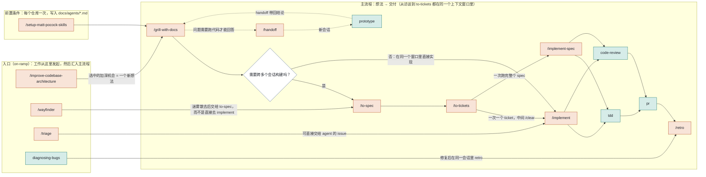
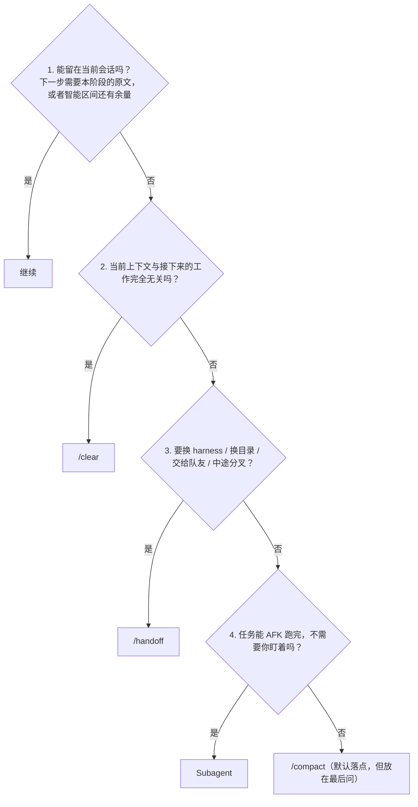
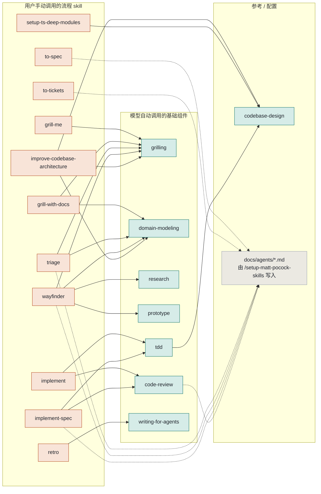

# Skill 地图

> mattpocock/skills 仓库里 38 个 skill 的地图：它们是什么、如何相互连接、改哪里成本最低。
> 它与仓库自带的文字版路由器 [`ask-matt`](skills/engineering/ask-matt/SKILL.md) 配套使用。
> 图例：**user** = 用户手动调用（user-invoked，只有你输入 `/name` 时才触发；frontmatter 里有 `disable-model-invocation: true`）；**model** = 模型自动调用（model-invoked，模型根据 description 调用它，你也可以手动调用）。

---

## 1. 工作流地图

**底层词汇和基础组件**（模型自动调用，由上面的 skill 引入）：

| 基础组件 | 它做什么 | 内部由谁调用 |
| --- | --- | --- |
| [`grilling`](skills/productivity/grilling/SKILL.md) | 访谈基础组件：按「前沿（frontier）」分轮提问，每个问题都附一个推荐答案 | grill-me, grill-with-docs, triage, wayfinder, improve-codebase-architecture |
| [`domain-modeling`](skills/engineering/domain-modeling/SKILL.md) | 维护 GLOSSARY.md 和 ADR 的方法纪律 | grill-with-docs, triage, wayfinder, improve-codebase-architecture |
| [`codebase-design`](skills/engineering/codebase-design/SKILL.md) | 深模块（deep module）词汇（模块 / 接口 / 深度 / 接缝） | tdd, improve-codebase-architecture, setup-ts-deep-modules |

**独立工具**（不在主流程上）：

| 工具 | 一句话 |
| --- | --- |
| [`/grill-me`](skills/productivity/grill-me/SKILL.md) | 没有仓库时的访谈；不写任何文件 |
| [`research`](skills/engineering/research/SKILL.md) | 后台 agent 对照一手资料做调研，产出一个带引用的 markdown 文件 |
| [`/to-questionnaire`](skills/productivity/to-questionnaire/SKILL.md) | 答案在别人脑子里：生成一份问卷让对方填写 |
| [`wizard`](skills/engineering/wizard/SKILL.md) | 生成一个 bash 向导，带人走完只有人能做的步骤（凭据、CI 密钥、第三方控制台） |
| [`/wait-what`](skills/productivity/wait-what/SKILL.md) | 你没跟上；用 GLOSSARY 的词汇重新解释 |
| [`/teach`](skills/productivity/teach/SKILL.md) | 把当前目录当作工作区，跨会话学习一个概念 |
| [`writing-for-agents`](skills/productivity/writing-for-agents/SKILL.md) | 如何写给 agent 读的文档 |

### 阶段边界：一个阶段结束时，如何进入下一个阶段

出自 [`PHASE-BOUNDARIES.md`](skills/engineering/ask-matt/PHASE-BOUNDARIES.md)。按顺序问，第一个「是」就是答案。继续没有任何成本，所以最先排除；`/compact` 是最常落到的结果，但放在最后问。

---

## 2. Skill 目录

共 38 个。只有 engineering 和 productivity（27 个）随 plugin 发布；in-progress 公开但不在 plugin 里；misc 偶尔使用；deprecated 目前为空。

### engineering（20 个，在 plugin 中）

| skill | 调用方 | 一句话 | 调用 → | 附带文件 / 读写 |
| --- | --- | --- | --- | --- |
| [`ask-matt`](skills/engineering/ask-matt/SKILL.md) | user | 路由器：问它该用哪个 skill 或流程。只导航，不干活 | | `PHASE-BOUNDARIES.md` |
| [`code-review`](skills/engineering/code-review/SKILL.md) | model | 从一个固定节点开始，在两个并行维度上审查 diff：Standards（编码规范 + Fowler 代码坏味道）和 Spec（是否忠实实现了 issue） | | 读 `CODING_STANDARDS.md` 和 tracker 里的 spec。需要 setup |
| [`codebase-design`](skills/engineering/codebase-design/SKILL.md) | model | 深模块词汇和 design-it-twice（设计两次）。纯参考 | | `DEEPENING.md`, `DESIGN-IT-TWICE.md` |
| [`diagnosing-bugs`](skills/engineering/diagnosing-bugs/SKILL.md) | model | 疑难 bug 的诊断循环：先建立一个会变红的反馈回路，然后最小化 → 提出假设 → 埋点 → 修复 → 回归测试 | | `scripts/` |
| [`domain-modeling`](skills/engineering/domain-modeling/SKILL.md) | model | 质疑模糊的术语，拆分一词多义，用场景做压力测试，就地更新 GLOSSARY.md 和 ADR | | `ADR-FORMAT.md`, `GLOSSARY-FORMAT.md`；写入 `GLOSSARY.md`, `docs/adr/` |
| [`grill-with-docs`](skills/engineering/grill-with-docs/SKILL.md) | user | 仓库内访谈 = grilling + domain-modeling，边聊边记录术语和决策。主流程的起点 | grilling, domain-modeling | 只有 7 行 |
| [`implement`](skills/engineering/implement/SKILL.md) | user | 领取一个 ticket，在约定的接缝上跑 tdd，经常跑 typecheck，用 code-review 收尾，然后 commit | tdd, code-review | 只有 17 行，最适合做个性化改造 |
| [`implement-spec`](skills/engineering/implement-spec/SKILL.md) | user | 把 ticket 当作任务图，为前沿上的 ticket 并行派发实现子 agent（每个在自己的 worktree 里），合并进集成分支，然后跑一次 code-review | tdd, code-review | 需要 setup |
| [`improve-codebase-architecture`](skills/engineering/improve-codebase-architecture/SKILL.md) | user | 扫描代码库里可以加深的模块，产出 HTML 报告，针对你选中的那个展开盘问。产出一个回到主流程的想法 | codebase-design, grilling, domain-modeling | `HTML-REPORT.md` |
| [`pr`](skills/engineering/pr/SKILL.md) | model | PR 描述的结构：最小化的可视化摘要，改动前后的证据，单向门还是双向门 + 影响范围 | | `CREDITS.md`（来自 Humanlayer show-me） |
| [`prototype`](skills/engineering/prototype/SKILL.md) | model | 回答一个设计问题的一次性代码：逻辑问题用单文件 HTML，UI 问题用多个变体。保存到 `prototype/<name>` branch | | `LOGIC.md`, `UI.md` |
| [`research`](skills/engineering/research/SKILL.md) | model | 后台 agent 对照一手资料做调研，把带引用的 markdown 文件写进仓库 | | 只有 12 行 |
| [`retro`](skills/engineering/retro/SKILL.md) | user | 回顾本次会话，为 agent 的「环境」提出改进建议：导航指针、自动化检查、编码规范、精简引导文件、工具经济性 | writing-for-agents | 建议修改 `CLAUDE.md`, `CODING_STANDARDS.md`, lint |
| [`setup-matt-pocock-skills`](skills/engineering/setup-matt-pocock-skills/SKILL.md) | user | 每个仓库一次：选择 tracker，设置分诊标签，设置领域文档布局 | | 写入 `docs/agents/issue-tracker.md`, `triage-labels.md`, `domain.md`；编辑 `CLAUDE.md` |
| [`tdd`](skills/engineering/tdd/SKILL.md) | model | 红-绿循环规则：只在事先确认的接缝上测试，一次一个垂直切片，重构留给审查 | codebase-design | `tests.md`, `mocking.md` |
| [`to-spec`](skills/engineering/to-spec/SKILL.md) | user | 不再提问，把对话综合成 spec 并发布到 tracker | | 需要 setup |
| [`to-tickets`](skills/engineering/to-tickets/SKILL.md) | user | 把 spec 拆成曳光弹（tracer bullet）ticket，每个 ticket 声明自己的阻塞边 | | 需要 setup；本地写入 `.scratch/<feature>/issues/` |
| [`triage`](skills/engineering/triage/SKILL.md) | user | 推动外部 issue / PR 走完分诊状态机，写出可直接交给 agent 的简报。不要对你自己用 to-tickets 拆出来的 ticket 做分诊 | grilling, domain-modeling | `AGENT-BRIEF.md`, `OUT-OF-SCOPE.md`；需要 setup |
| [`wayfinder`](skills/engineering/wayfinder/SKILL.md) | user | 用于一个会话装不下的大工作：在 tracker 上建立一张决策 ticket 的地图，逐个解决，产出的是决策而不是交付物 | grilling, domain-modeling, research, prototype | 需要 setup |
| [`wizard`](skills/engineering/wizard/SKILL.md) | model | 为只有人能做的步骤生成交互式 bash 向导；值写入 `.env` 和 GitHub secrets | | `template.sh` |

### productivity（7 个，在 plugin 中）

| skill | 调用方 | 一句话 | 调用 → | 附带文件 / 读写 |
| --- | --- | --- | --- | --- |
| [`grill-me`](skills/productivity/grill-me/SKILL.md) | user | 不写文件的无状态访谈。没有仓库时用 | grilling | 只有 7 行 |
| [`grilling`](skills/productivity/grilling/SKILL.md) | model | 访谈基础组件：决策树、前沿、轮次、每个问题附推荐答案；agent 查事实，你做决定 | | 30 行；改它就能改变访谈的语气 |
| [`handoff`](skills/productivity/handoff/SKILL.md) | user | 把对话压缩成一份交接文档，存到系统临时目录，列出下一个 agent 应该调用哪些 skill | | 写入 `$TMPDIR` |
| [`teach`](skills/productivity/teach/SKILL.md) | user | 把当前目录当作学习工作区，跨会话教一个概念 | | `MISSION-FORMAT.md` 和另外 3 个格式文件 |
| [`to-questionnaire`](skills/productivity/to-questionnaire/SKILL.md) | user | 先就「发给谁、你需要什么」访谈你，再生成一份问卷让对方填写 | | 写入问卷 md |
| [`wait-what`](skills/productivity/wait-what/SKILL.md) | user | 你没跟上上一条消息；用 GLOSSARY 的词汇以大白话重新解释 | | 读 `GLOSSARY.md` |
| [`writing-for-agents`](skills/productivity/writing-for-agents/SKILL.md) | model | 如何写 skill、AGENTS.md 以及指针指向的文档 | | `SKILL-MECHANICS.md` |

### in-progress（7 个，公开 beta，不在 plugin 中，没有文档页）

| skill | 调用方 | 一句话 | 调用 → |
| --- | --- | --- | --- |
| [`chief-of-staff`](skills/in-progress/chief-of-staff/SKILL.md) | user | 由一个会话协调多个子 agent 追逐一个长期目标；记忆放在一个按日期组织、引用 commit 的 wiki 里 | |
| [`claude-handoff`](skills/in-progress/claude-handoff/SKILL.md) | user | 写一份交接摘要，然后用 `claude --bg` 启动一个后台 agent 立即接着干 | |
| [`loop-me`](skills/in-progress/loop-me/SKILL.md) | user | 有状态的盘问，只产出一份「工作流」spec | |
| [`setup-ts-deep-modules`](skills/in-progress/setup-ts-deep-modules/SKILL.md) | user | 在 TS 仓库里接入 dependency-cruiser，强制每个 package 只能通过它的入口文件访问 | codebase-design |
| [`writing-beats`](skills/in-progress/writing-beats/SKILL.md) | user | 写作 exploit（利用）阶段：把素材组织成一系列节拍（beat） | |
| [`writing-fragments`](skills/in-progress/writing-fragments/SKILL.md) | user | 写作 explore（探索）阶段：用盘问挖出零散的片段 | |
| [`writing-shape`](skills/in-progress/writing-shape/SKILL.md) | user | 写作 exploit（利用）阶段：把原始素材逐节塑造成一篇文章 | |

### misc（4 个，保留但很少用，不在 plugin 中）

| skill | 调用方 | 一句话 |
| --- | --- | --- |
| [`git-guardrails-claude-code`](skills/misc/git-guardrails-claude-code/SKILL.md) | model | 拦截危险 git 命令的 Claude Code hook |
| [`migrate-to-shoehorn`](skills/misc/migrate-to-shoehorn/SKILL.md) | model | 把测试里的 `as` 断言迁移到 @total-typescript/shoehorn |
| [`scaffold-exercises`](skills/misc/scaffold-exercises/SKILL.md) | model | 为课程练习生成目录结构 |
| [`setup-pre-commit`](skills/misc/setup-pre-commit/SKILL.md) | model | Husky + lint-staged 的 pre-commit hook |

### Fork 扩展（zxsong111/skills 新增的 7 个，来自 claude-config）

| skill | 分类目录 | 调用方 | 一句话 | 调用 → |
| --- | --- | --- | --- | --- |
| [`commit-push-pr`](skills/engineering/commit-push-pr/SKILL.md) | engineering | model | 按约定 commit、push、开 PR；在主干分支上会停下来询问；调用 `pr` 来写 PR 正文 | pr |
| [`receiving-code-review`](skills/engineering/receiving-code-review/SKILL.md) | engineering | model | 先验证审查反馈再动手；反复出现的判断性规则回流进 `CODING_STANDARDS.md` | |
| [`security-and-hardening`](skills/engineering/security-and-hardening/SKILL.md) | engineering | model | 针对认证 / 支付 / PII / 上传 / webhook 的安全清单；先画出信任边界 | diagnosing-bugs |
| [`improve-claude-md`](skills/engineering/improve-claude-md/SKILL.md) | engineering | model | 审查并改进 CLAUDE.md / AGENTS.md / .claude/rules，从一份 29 类的菜单生成约定；先报告（report-first） | |
| [`resume-handoff`](skills/productivity/resume-handoff/SKILL.md) | productivity | user | 新会话找到 `/handoff` 留下的交接文档，核对当前状态，然后接着干 | |
| [`humanizer`](skills/productivity/humanizer/SKILL.md) | productivity | model | 模型写文字（PR 描述、README、文档）时去掉 AI 腔 | |
| [`i-have-adhd`](skills/productivity/i-have-adhd/SKILL.md) | productivity | model | 回复以行动开头，步骤编号列出，没有铺垫，也没有客套 | |

在工作流地图中的位置：`commit-push-pr` 和 `receiving-code-review` 跟在 code-review 之后；`improve-claude-md` 和 setup-matt-pocock-skills 一样是前置条件；其余的都是独立工具。

### deprecated（0 个）

退役的 skill 会被直接删除，并由 changeset 写明它的替代品；它的文档页保留，并标记为已归档。

---

## 3. 调用图

实线来自 SKILL.md 里的操作性指令 `Call the Skill tool with "x"`。虚线表示该 skill 会读取 `/setup-matt-pocock-skills` 写入的 `docs/agents/*.md`；setup 是用户手动调用的，所以没有东西能调用它，skill 只能提示你去运行它。

从图中可以看出的要点：

- **grilling 是复用最多的基础组件**：五个流程 skill 在内部运行它。想改访谈风格，只需改这一个文件。
- **grill-with-docs 只有 7 行**：它就是两次调用，grilling 和 domain-modeling。想做你自己的「带文档的访谈」，复制它再加一行就行。
- **implement 只有 17 行**：领取 ticket、tdd、typecheck、code-review、commit。这是个性化改造最常动的地方。
- **codebase-design 和 writing-for-agents 是纯参考**：没有步骤，只有词汇和写作指导。
- **硬性不变量**：用户手动调用的 skill 可以调用模型自动调用的 skill，反过来绝不行（[`.agents/invocation.md`](.agents/invocation.md)）。

---

## 4. 定制指南

按改动成本从低到高排列。前两层不需要理解仓库的维护约定；从第三层开始，改动必须同步到其他文件，否则路由器就会「说谎」。

### 第 1 层：改配置，不碰任何 skill

运行一次 `/setup-matt-pocock-skills`。它会写入三个配置文件，每个流程 skill 都从中读取：

| 文件 | 谁读它 | 你可以改什么 |
| --- | --- | --- |
| `docs/agents/issue-tracker.md` | to-spec, to-tickets, triage, wayfinder, implement-spec, implement | 更换 tracker（GitHub / GitLab / 本地 `.scratch/` / 自定义命令），PR 是否进入分诊队列 |
| `docs/agents/triage-labels.md` | triage | 把分诊角色映射到你自己的标签名 |
| `docs/agents/domain.md` | domain-modeling, grill-with-docs, wait-what, tdd | GLOSSARY.md 和 ADR 放在哪里，单一上下文还是包含多个上下文的 monorepo |
| `CODING_STANDARDS.md` | code-review 的 Standards 维度 | 你的编码规范；retro 建议把「判断性的」规则加到这里，机械性的规则则交给 lint |
| `CLAUDE.md` / `AGENTS.md` | 所有 agent | setup 只添加一个 `## Agent skills` 小节；retro 的原则是这个文件只放导航指针 |

### 第 2 层：把主流程裁剪成你自己的流程（不改文件）

- **小改动**：`/grill-with-docs` → `/implement`，两步。implement 已经包含 tdd 和 code-review。
- **跨多个会话**：加上 `/to-spec` → `/to-tickets`，然后用 `/implement` 一次做一个 ticket（中间 `/clear`），或者用 `/implement-spec` 把整批并行跑完。
- **修 bug**：`/diagnosing-bugs` → 同一会话里 `/retro`。
- **外部 issue**：`/triage` 产出一份可直接交给 agent 的简报，然后 `/implement`。不要对你自己用 to-tickets 拆出来的 ticket 做分诊。
- **每次构建之后**：`/retro`。它改变的是环境（lint、规范、导航指针），这样下一次运行就会少踩同样的坑。

### 第 3 层：改一个 skill 的行为

- **保持 frontmatter 和 openai.yaml 同步**：每个 skill 目录都有 `SKILL.md` 和 `agents/openai.yaml`。用户手动调用的 skill 需要同时有 `disable-model-invocation: true` 和 `policy.allow_implicit_invocation: false`；要么两个都有，要么都没有。
- **description 写给谁看**：用户手动调用 skill 的 description 是写给人看的（一句话）；模型自动调用 skill 的 description 是写给模型看的，必须带触发短语（「Use when the user wants...」），否则模型不会自动调用它。
- **调用另一个 skill**：写 `Call the Skill tool with "x"`，而不是 `/x`，也不要跨目录链接到另一个 skill 的文件。你只能调用模型自动调用的 skill；当某个用户手动调用的 skill 是前置条件时，写「告诉用户运行 /setup-...」。
- **想让模型自动使用一个用户手动调用的 skill**：去掉上面那两个标记，并把 description 改写成触发短语。反过来也是同样的做法。

最值得优先改的三个文件：`implement/SKILL.md`（17 行，你的实现循环）、`grilling/SKILL.md`（30 行，每次访谈的语气和轮次格式），以及 `retro/SKILL.md`（复盘要看哪些类别）。

### 第 4 层：改流程本身

流程写在 `ask-matt/SKILL.md`（主流程、入口、独立工具）和 `ask-matt/PHASE-BOUNDARIES.md`（阶段边界决策树）里。ask-matt 是用户手动调用的，所以只有你会读它，改它没有副作用。仓库约定：任何用户可触发 skill 的新增、删除或重命名，都必须回来同步这个路由器。

### 第 5 层：新增 / 删除 / 移动一个 skill

仓库 [`CLAUDE.md`](CLAUDE.md) 规定的同步清单：

| 放在 | 必须同步 | 不能出现在 |
| --- | --- | --- |
| `engineering/` 或 `productivity/`（在 plugin 中） | 顶层 README 条目（链接到 SKILL.md）、分类目录 README、`.claude-plugin/plugin.json` 里的 skills 数组、`docs/<bucket>/<name>.md` 文档页（四个部分：它做什么 / 什么时候用 / 常见问题 / 起作用的标志）、ask-matt 路由器 | |
| `in-progress/` | 分类目录 README | 顶层 README、plugin.json、docs/ |
| `misc/` | 分类目录 README | 同上 |
| `deprecated/` | 删除文件，changeset 写明替代品；原有的文档页保留并标记为已归档 | 同上 |

- 改完清单（manifest）后，运行 `claude plugin validate . --strict`。
- 运行 `scripts/link-skills.sh`，把 deprecated 和 misc 之外的所有 skill 符号链接到 `~/.claude/skills` 和 `~/.agents/skills`；之后 `git pull` 就能更新它们。
- 仓库里任何文字都不用破折号类标点（如果你要向上游贡献，要注意这一点）。
- skill 本身按照 `/writing-for-agents` 来写：触发短语放在 description 里，正文只保留操作性步骤，参考资料拆到同目录下的 md 文件里。

### 建议的个性化路径

1. **原样跑两周**：只做第 1 层的配置。记下 code-review 提出的问题和 retro 的建议；这就是你 `CODING_STANDARDS.md` 的初稿。
2. **fork 之后，把个人 skill 放进 `in-progress/`**：公开、可以符号链接，而且不用维护 docs 或 plugin.json。稳定后再提升到 engineering。
3. **把 implement 改成你自己的循环**：比如加上「跑 lint」「更新 CHANGELOG」「本地 e2e」。它是用户手动调用的，所以改它不会影响模型的自动行为。
4. **写你自己的 ask-matt**：删掉你不用的条目（比如你不用 wayfinder），加上你自己的 skill（部署、发布、迁移），让路由器只描述你真正在走的流程。
5. **守住两个不变量**：用户手动调用的 skill 不被其他 skill 调用；从访谈到 to-tickets 的主流程留在同一个上下文窗口里。其他一切由你决定。

### 流程会在仓库里留下什么

| 产物 | 由谁写入 | 由谁读取 |
| --- | --- | --- |
| `GLOSSARY.md`, `docs/adr/` | domain-modeling（经由 grill-with-docs、triage、wayfinder、improve-codebase-architecture） | tdd, code-review, wait-what, pr, diagnosing-bugs, teach |
| spec、ticket（tracker 或 `.scratch/<feature>/`） | to-spec, to-tickets, triage, wayfinder | implement, implement-spec, code-review 的 Spec 维度 |
| `prototype/<name>` branch | prototype | 实现 issue 里的指针 |
| 调研笔记 `*.md` | research（后台） | grill-with-docs, wayfinder, implement-spec 的子 agent |
| 交接文档（系统临时目录） | handoff / claude-handoff | 下一个会话 |
| `.env`、GitHub secrets | wizard 生成的脚本（由人运行） | 应用程序 |
| `CODING_STANDARDS.md`、lint 规则、导航指针 | retro（提建议，你批准） | code-review、所有 agent |
