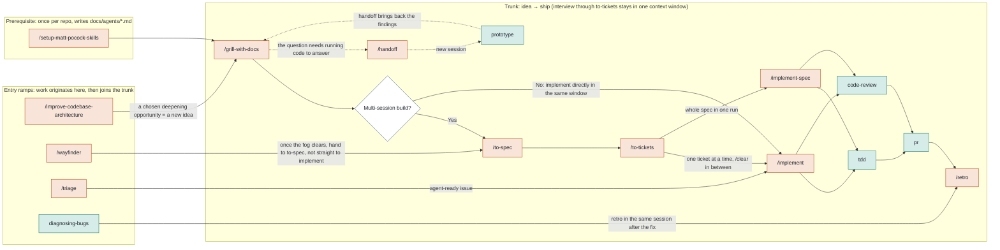
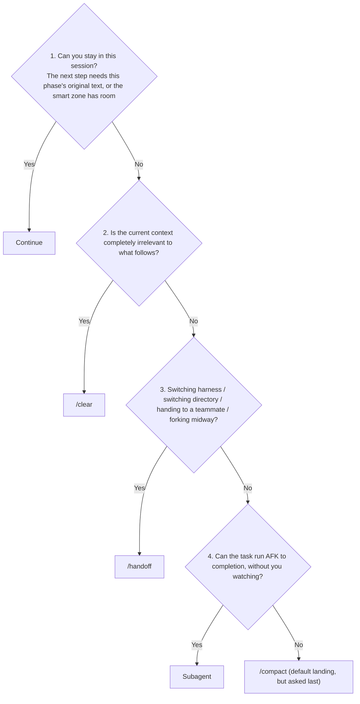
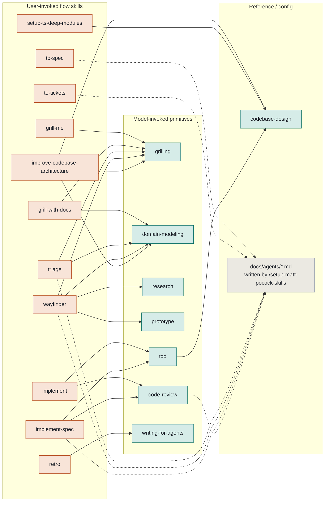

# Skills Map

> A map of the 38 skills in the mattpocock/skills repo: what they are, how they connect, and where changes are cheapest.
> It pairs with the repo's own text router, [`ask-matt`](skills/engineering/ask-matt/SKILL.md).
> Legend: **user** = user-invoked (only fires when you type `/name`; the frontmatter has `disable-model-invocation: true`); **model** = model-invoked (the model calls it based on its description, and you can also call it by hand).

---

## 1. Workflow map

**Underlying vocabulary and primitives** (model-invoked, pulled in by the skills above):

| Primitive | What it does | Who calls it internally |
| --- | --- | --- |
| [`grilling`](skills/productivity/grilling/SKILL.md) | Interview primitive: asks in rounds by "frontier", each question comes with a recommended answer | grill-me, grill-with-docs, triage, wayfinder, improve-codebase-architecture |
| [`domain-modeling`](skills/engineering/domain-modeling/SKILL.md) | The discipline for maintaining GLOSSARY.md and ADRs | grill-with-docs, triage, wayfinder, improve-codebase-architecture |
| [`codebase-design`](skills/engineering/codebase-design/SKILL.md) | Deep module vocabulary (module / interface / depth / seam) | tdd, improve-codebase-architecture, setup-ts-deep-modules |

**Standalone tools** (not on the trunk):

| Tool | In one line |
| --- | --- |
| [`/grill-me`](skills/productivity/grill-me/SKILL.md) | Interview when there is no repo; writes no files |
| [`research`](skills/engineering/research/SKILL.md) | A background agent researches against primary sources and produces a markdown file with citations |
| [`/to-questionnaire`](skills/productivity/to-questionnaire/SKILL.md) | The answer lives in someone else's head: generates a questionnaire for them to fill in |
| [`wizard`](skills/engineering/wizard/SKILL.md) | Generates a bash wizard that walks a person through steps only a person can do (credentials, CI secrets, third-party dashboards) |
| [`/wait-what`](skills/productivity/wait-what/SKILL.md) | You did not follow; re-explains using GLOSSARY vocabulary |
| [`/teach`](skills/productivity/teach/SKILL.md) | Uses the current directory as a workspace to learn one concept across sessions |
| [`writing-for-agents`](skills/productivity/writing-for-agents/SKILL.md) | How to write documents that agents will read |

### Phase boundaries: when one phase ends, how to move to the next

From [`PHASE-BOUNDARIES.md`](skills/engineering/ask-matt/PHASE-BOUNDARIES.md). Ask in order; the first "yes" is the answer. Continue costs nothing, so it is ruled out first; `/compact` is where you land most often, but it is asked last.

---

## 2. Skill catalog

38 in total. Only engineering and productivity (27) ship in the plugin; in-progress is public but not in the plugin; misc is occasionally used; deprecated is currently empty.

### engineering (20, in plugin)

| skill | invoked by | In one line | Calls → | Bundled files / reads and writes |
| --- | --- | --- | --- | --- |
| [`ask-matt`](skills/engineering/ask-matt/SKILL.md) | user | Router: ask it which skill or flow to use. Navigates only, does no work | | `PHASE-BOUNDARIES.md` |
| [`code-review`](skills/engineering/code-review/SKILL.md) | model | Reviews the diff from a fixed point on two parallel axes: Standards (coding standards + Fowler code smells) and Spec (does it faithfully implement the issue) | | Reads `CODING_STANDARDS.md` and the spec in the tracker. Needs setup |
| [`codebase-design`](skills/engineering/codebase-design/SKILL.md) | model | Deep module vocabulary and design-it-twice. Pure reference | | `DEEPENING.md`, `DESIGN-IT-TWICE.md` |
| [`diagnosing-bugs`](skills/engineering/diagnosing-bugs/SKILL.md) | model | Diagnosis loop for hard bugs: first build a feedback loop that goes red, then minimize → hypothesize → instrument → fix → regression test | | `scripts/` |
| [`domain-modeling`](skills/engineering/domain-modeling/SKILL.md) | model | Challenges fuzzy terms, splits words with multiple meanings, stress-tests with scenarios, updates GLOSSARY.md and ADRs in place | | `ADR-FORMAT.md`, `GLOSSARY-FORMAT.md`; writes `GLOSSARY.md`, `docs/adr/` |
| [`grill-with-docs`](skills/engineering/grill-with-docs/SKILL.md) | user | In-repo interview = grilling + domain-modeling, capturing terms and decisions as you go. Start of the trunk | grilling, domain-modeling | Only 7 lines |
| [`implement`](skills/engineering/implement/SKILL.md) | user | Picks up a ticket, runs tdd on the agreed seam, runs typecheck often, finishes with code-review, commits | tdd, code-review | Only 17 lines, the best place for personalization |
| [`implement-spec`](skills/engineering/implement-spec/SKILL.md) | user | Treats tickets as a task graph, dispatches implementer subagents in parallel for frontier tickets (each in its own worktree), merges into an integration branch, then runs one code-review | tdd, code-review | Needs setup |
| [`improve-codebase-architecture`](skills/engineering/improve-codebase-architecture/SKILL.md) | user | Scans the codebase for modules that can be deepened, produces an HTML report, grills on the one you pick. Produces one idea that returns to the trunk | codebase-design, grilling, domain-modeling | `HTML-REPORT.md` |
| [`pr`](skills/engineering/pr/SKILL.md) | model | The shape of a PR description: a minimal visual summary, before/after evidence, one-way or two-way door + blast radius | | `CREDITS.md` (from Humanlayer show-me) |
| [`prototype`](skills/engineering/prototype/SKILL.md) | model | Throwaway code that answers one design question: single-file HTML for logic, multiple variants for UI. Saved to a `prototype/<name>` branch | | `LOGIC.md`, `UI.md` |
| [`research`](skills/engineering/research/SKILL.md) | model | A background agent researches against primary sources and writes a markdown file with citations into the repo | | Only 12 lines |
| [`retro`](skills/engineering/retro/SKILL.md) | user | Reviews the session and suggests improvements to the agent's "environment": navigation pointers, automated checks, coding standards, slimming steering files, tool economy | writing-for-agents | Suggests edits to `CLAUDE.md`, `CODING_STANDARDS.md`, lint |
| [`setup-matt-pocock-skills`](skills/engineering/setup-matt-pocock-skills/SKILL.md) | user | Once per repo: choose a tracker, set triage labels, set the domain docs layout | | Writes `docs/agents/issue-tracker.md`, `triage-labels.md`, `domain.md`; edits `CLAUDE.md` |
| [`tdd`](skills/engineering/tdd/SKILL.md) | model | Red-green loop rules: test only on a seam confirmed in advance, one vertical slice at a time, leave refactoring to review | codebase-design | `tests.md`, `mocking.md` |
| [`to-spec`](skills/engineering/to-spec/SKILL.md) | user | Asks no more questions, synthesizes the conversation into a spec and publishes it to the tracker | | Needs setup |
| [`to-tickets`](skills/engineering/to-tickets/SKILL.md) | user | Splits a spec into tracer-bullet tickets, each declaring its blocking edges | | Needs setup; locally writes `.scratch/<feature>/issues/` |
| [`triage`](skills/engineering/triage/SKILL.md) | user | Pushes external issues / PRs through the triage state machine, writes an agent-ready brief. Do not triage tickets you made yourself with to-tickets | grilling, domain-modeling | `AGENT-BRIEF.md`, `OUT-OF-SCOPE.md`; needs setup |
| [`wayfinder`](skills/engineering/wayfinder/SKILL.md) | user | For big work that does not fit in one session: builds a map of decision tickets on the tracker, resolves them one by one, produces decisions rather than deliverables | grilling, domain-modeling, research, prototype | Needs setup |
| [`wizard`](skills/engineering/wizard/SKILL.md) | model | Generates an interactive bash wizard for steps only a person can do; values are written to `.env` and GitHub secrets | | `template.sh` |

### productivity (7, in plugin)

| skill | invoked by | In one line | Calls → | Bundled files / reads and writes |
| --- | --- | --- | --- | --- |
| [`grill-me`](skills/productivity/grill-me/SKILL.md) | user | Stateless interview that writes no files. Use when there is no repo | grilling | Only 7 lines |
| [`grilling`](skills/productivity/grilling/SKILL.md) | model | Interview primitive: design tree, frontier, rounds, a recommended answer with every question; the agent looks up facts, you make decisions | | 30 lines; edit it to change the interview tone |
| [`handoff`](skills/productivity/handoff/SKILL.md) | user | Compresses the conversation into a handoff document saved to the system temp directory, lists which skills the next agent should call | | Writes `$TMPDIR` |
| [`teach`](skills/productivity/teach/SKILL.md) | user | Treats the current directory as a learning workspace, teaches one concept across sessions | | `MISSION-FORMAT.md` and 3 other format files |
| [`to-questionnaire`](skills/productivity/to-questionnaire/SKILL.md) | user | First interviews you on "who is it for, what do you need", then generates a questionnaire for them to fill in | | Writes the questionnaire md |
| [`wait-what`](skills/productivity/wait-what/SKILL.md) | user | You did not follow the last message; re-explains it in plain language using GLOSSARY vocabulary | | Reads `GLOSSARY.md` |
| [`writing-for-agents`](skills/productivity/writing-for-agents/SKILL.md) | model | How to write skills, AGENTS.md, and documents that pointers point to | | `SKILL-MECHANICS.md` |

### in-progress (7, public beta, not in plugin, no docs pages)

| skill | invoked by | In one line | Calls → |
| --- | --- | --- | --- |
| [`chief-of-staff`](skills/in-progress/chief-of-staff/SKILL.md) | user | One session coordinates subagents chasing a long-term goal; memory lives in a dated wiki that cites commits | |
| [`claude-handoff`](skills/in-progress/claude-handoff/SKILL.md) | user | Writes a handoff summary, then starts a background agent with `claude --bg` to carry on immediately | |
| [`loop-me`](skills/in-progress/loop-me/SKILL.md) | user | Stateful grilling that produces only a "workflow" spec | |
| [`setup-ts-deep-modules`](skills/in-progress/setup-ts-deep-modules/SKILL.md) | user | Wires dependency-cruiser into a TS repo, enforcing that each package is accessed only through its entry file | codebase-design |
| [`writing-beats`](skills/in-progress/writing-beats/SKILL.md) | user | Writing exploit: organizes material into a series of beats | |
| [`writing-fragments`](skills/in-progress/writing-fragments/SKILL.md) | user | Writing explore: uses grilling to dig out scattered fragments | |
| [`writing-shape`](skills/in-progress/writing-shape/SKILL.md) | user | Writing exploit: shapes raw material into an article section by section | |

### misc (4, kept around but rarely used, not in plugin)

| skill | invoked by | In one line |
| --- | --- | --- |
| [`git-guardrails-claude-code`](skills/misc/git-guardrails-claude-code/SKILL.md) | model | Claude Code hooks that block dangerous git commands |
| [`migrate-to-shoehorn`](skills/misc/migrate-to-shoehorn/SKILL.md) | model | Migrates `as` assertions in tests to @total-typescript/shoehorn |
| [`scaffold-exercises`](skills/misc/scaffold-exercises/SKILL.md) | model | Generates the directory structure for course exercises |
| [`setup-pre-commit`](skills/misc/setup-pre-commit/SKILL.md) | model | Husky + lint-staged pre-commit hooks |

### Fork extensions (7 added in zxsong111/skills, from claude-config)

| skill | bucket | invoked by | In one line | Calls → |
| --- | --- | --- | --- | --- |
| [`commit-push-pr`](skills/engineering/commit-push-pr/SKILL.md) | engineering | model | Commits per convention, pushes, opens a PR; stops and asks on the trunk branch; calls `pr` for the PR body | pr |
| [`receiving-code-review`](skills/engineering/receiving-code-review/SKILL.md) | engineering | model | Verifies review feedback before acting on it; recurring judgment-type rules flow back into `CODING_STANDARDS.md` | |
| [`security-and-hardening`](skills/engineering/security-and-hardening/SKILL.md) | engineering | model | Security checklist for auth / payments / PII / uploads / webhooks; draws the trust boundary first | diagnosing-bugs |
| [`improve-claude-md`](skills/engineering/improve-claude-md/SKILL.md) | engineering | model | Reviews and improves CLAUDE.md / AGENTS.md / .claude/rules, generates conventions from a 29-category menu; report-first | |
| [`resume-handoff`](skills/productivity/resume-handoff/SKILL.md) | productivity | user | A new session finds the handoff document from `/handoff`, checks the current state, and continues the work | |
| [`humanizer`](skills/productivity/humanizer/SKILL.md) | productivity | model | Removes the AI tone when the model writes prose (PR descriptions, README, docs) | |
| [`i-have-adhd`](skills/productivity/i-have-adhd/SKILL.md) | productivity | model | Replies lead with the action, steps are numbered, no preamble and no pleasantries | |

Position in the workflow map: `commit-push-pr` and `receiving-code-review` follow code-review; `improve-claude-md` is a prerequisite alongside setup-matt-pocock-skills; the rest are standalone tools.

### deprecated (0)

A retired skill is deleted outright, and the changeset names its replacement; its docs page stays and is marked archived.

---

## 3. Call graph

Solid lines come from operative instructions in SKILL.md, `Call the Skill tool with "x"`. Dashed lines mean the skill reads the `docs/agents/*.md` written by `/setup-matt-pocock-skills`; setup is user-invoked, so nothing can call it, and a skill can only prompt you to run it.

Key points from the graph:

- **grilling is the most reused primitive**: five flow skills run it internally. To change the interview style, edit only this one file.
- **grill-with-docs is only 7 lines**: it is just two calls, grilling and domain-modeling. To make your own "interview with docs", copy it and add a line.
- **implement is only 17 lines**: pick up a ticket, tdd, typecheck, code-review, commit. This is the place personalization changes most often.
- **codebase-design and writing-for-agents are pure reference**: no steps, only vocabulary and writing guidance.
- **Hard invariant**: a user-invoked skill can call a model-invoked skill, never the other way around ([`.agents/invocation.md`](.agents/invocation.md)).

---

## 4. Customization guide

Ordered from lowest to highest cost of change. The first two tiers do not require understanding the repo's maintenance conventions; from the third tier on, changes must be synced to other files, otherwise the router "lies".

### Tier 1: change config, do not touch any skill

Run `/setup-matt-pocock-skills` once. It writes three config files, and every flow skill reads from them:

| File | Who reads it | What you can change |
| --- | --- | --- |
| `docs/agents/issue-tracker.md` | to-spec, to-tickets, triage, wayfinder, implement-spec, implement | Swap the tracker (GitHub / GitLab / local `.scratch/` / custom command), whether PRs enter the triage queue |
| `docs/agents/triage-labels.md` | triage | Map the triage roles to your own label names |
| `docs/agents/domain.md` | domain-modeling, grill-with-docs, wait-what, tdd | Where GLOSSARY.md and ADRs live, single context or monorepo with multiple contexts |
| `CODING_STANDARDS.md` | the Standards axis of code-review | Your coding standards; retro suggests adding "judgment-type" rules here, while mechanical rules go to lint |
| `CLAUDE.md` / `AGENTS.md` | all agents | setup adds only a `## Agent skills` section; retro's principle is that this file holds only navigation pointers |

### Tier 2: trim the trunk into your own flow (no file changes)

- **Small change**: `/grill-with-docs` → `/implement`, two steps. implement already includes tdd and code-review.
- **Multi-session**: add `/to-spec` → `/to-tickets`, then `/implement` one ticket at a time (with `/clear` in between), or `/implement-spec` to run the whole bundle in parallel.
- **Fixing a bug**: `/diagnosing-bugs` → `/retro` in the same session.
- **External issue**: `/triage` produces an agent-ready brief, then `/implement`. Do not triage tickets you made yourself with to-tickets.
- **After every build**: `/retro`. It changes the environment (lint, standards, navigation pointers), so the next run hits fewer of the same pitfalls.

### Tier 3: change one skill's behavior

- **Keep frontmatter and openai.yaml in sync**: each skill directory has `SKILL.md` and `agents/openai.yaml`. A user-invoked skill needs both `disable-model-invocation: true` and `policy.allow_implicit_invocation: false`; either both are present or neither.
- **Who the description is for**: a user-invoked skill's description is for humans (one sentence); a model-invoked skill's description is for the model and must carry trigger phrases ("Use when the user wants..."), otherwise the model will not call it automatically.
- **Calling another skill**: write `Call the Skill tool with "x"`, not `/x`, and do not link across directories to another skill's files. You can only call model-invoked skills; when a user-invoked skill is a prerequisite, write "tell the user to run /setup-...".
- **To let the model use a user-invoked skill automatically**: remove the two markers above and rewrite the description as trigger phrases. The reverse works the same way.

The three files most worth changing first: `implement/SKILL.md` (17 lines, your implementation loop), `grilling/SKILL.md` (30 lines, the tone and round format of every interview), and `retro/SKILL.md` (which categories the retrospective looks at).

### Tier 4: change the flow itself

The flow is written in `ask-matt/SKILL.md` (trunk, entry ramps, standalone tools) and `ask-matt/PHASE-BOUNDARIES.md` (the phase-boundary decision tree). ask-matt is user-invoked, so only you read it, and changing it has no side effects. Repo convention: any add, remove, or rename of a user-reachable skill must come back and sync this router.

### Tier 5: add / remove / move a skill

The sync checklist set by the repo's [`CLAUDE.md`](CLAUDE.md):

| Placed in | Must sync | Must not appear in |
| --- | --- | --- |
| `engineering/` or `productivity/` (in plugin) | Top-level README entry (linking to SKILL.md), bucket README, the skills array in `.claude-plugin/plugin.json`, the `docs/<bucket>/<name>.md` docs page (four sections: What it does / When to reach for it / Common questions / It's working if), the ask-matt router | |
| `in-progress/` | bucket README | Top-level README, plugin.json, docs/ |
| `misc/` | bucket README | Same as above |
| `deprecated/` | Delete the files, changeset names the replacement; the original docs page stays and is marked archived | Same as above |

- After changing a manifest, run `claude plugin validate . --strict`.
- Run `scripts/link-skills.sh` to symlink every skill except deprecated and misc into `~/.claude/skills` and `~/.agents/skills`; after that, `git pull` updates them.
- No em-dashes in prose anywhere in the repo (watch this if you contribute back upstream).
- Write skills themselves following `/writing-for-agents`: put trigger phrases in the description, keep only operative steps in the body, and split reference material into md files in the same directory.

### Suggested personalization path

1. **Run it as-is for two weeks**: do only the Tier 1 config. Note the problems code-review raises and retro's suggestions; that is your first draft of `CODING_STANDARDS.md`.
2. **After forking, put personal skills in `in-progress/`**: public, symlinkable, and no docs or plugin.json to maintain. Promote to engineering once stable.
3. **Turn implement into your own loop**: for example add "run lint", "update CHANGELOG", "local e2e". It is user-invoked, so changing it does not affect the model's automatic behavior.
4. **Write your own ask-matt**: delete the entries you do not use (say, if you do not use wayfinder), add your own skills (deploy, release, migration), so the router describes only the flow you really follow.
5. **Keep the two invariants**: user-invoked skills are not called by other skills; the trunk from interview to to-tickets stays in one context window. Everything else is up to you.

### What the flow leaves in the repo

| Artifact | Written by | Read by |
| --- | --- | --- |
| `GLOSSARY.md`, `docs/adr/` | domain-modeling (via grill-with-docs, triage, wayfinder, improve-codebase-architecture) | tdd, code-review, wait-what, pr, diagnosing-bugs, teach |
| spec, tickets (tracker or `.scratch/<feature>/`) | to-spec, to-tickets, triage, wayfinder | implement, implement-spec, the Spec axis of code-review |
| `prototype/<name>` branch | prototype | the pointer inside the implementation issue |
| Research notes `*.md` | research (background) | grill-with-docs, wayfinder, implement-spec's subagents |
| Handoff document (system temp directory) | handoff / claude-handoff | the next session |
| `.env`, GitHub secrets | the script wizard generates (run by a person) | the application |
| `CODING_STANDARDS.md`, lint rules, navigation pointers | retro (suggests, you approve) | code-review, all agents |
