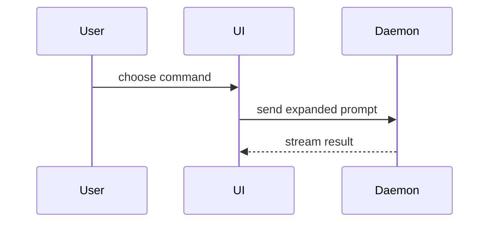

用这个模板撰写 PR 正文：

```markdown
## Summary

<图示、diff 草图或树>

## Evidence

- **Before:** <截图/输出/失败的测试运行>
  **After:** <截图/输出/通过的测试运行>

## Merge Danger

**Door:** <单向门或双向门>

<可选：说明>

**Blast Radius:** <一个词的描述>

<可选：merge 可能带来的连锁影响>
```

## 各部分说明

省掉所有开场白，文字保持简短。使用 `GLOSSARY.md` 中用户的领域语言。

### Summary（摘要）

挑选能把要点讲清楚的最小视图。

- 用伪代码展示逻辑或算法：

```text
on(save)
  if content is unchanged
    return cached result
  write new content
  return fresh result
```

- 用调用树展示运行时的控制流：

```text
submitForm
  createSession
    persistPrompt
    launchAgent
  navigateToSession
```

- 用组件树展示 UI 结构，包括有意义的状态和模块边界：

```text
<SessionPage> (apps/example/src/routes/session.tsx)
  useSessionEvents()
  <SessionToolbar>
    <RunSkillButton> (packages/ui)
```

- 用浅层文件树展示文件职责或大范围重构：

```text
src/
├── commands/       # 解析用户操作
├── sessions/       # 持有会话状态
└── transport/      # 发送 API 请求
```

- 用 Mermaid 展示组件交互、控制流或数据流：



- 当重点是改了什么、且周边结构已经存在时，用 `diff`。让 diff 的形态与主题相匹配。

组件变更：

```diff
 <SessionPage>
   useSessionEvents()
   <SessionToolbar>
+    <RunSkillButton />
   <SessionTimeline>
+    <SkillResultCard />
```

文件布局变更：

```diff
 src/
 ├── commands/
+│   └── show-me.ts       # 展开 slash command
 ├── sessions/
-└── transport.ts
+└── transport/
+    ├── client.ts
+    └── stream.ts
```

调用树或调用栈变更：

```diff
 submitForm
   createSession
     persistPrompt
+    expandSkillMention
     launchAgent
-  navigateToSession
+  navigateToSession
+    subscribeToEvents
```

状态或控制流变更：

```diff
 on(save)
-  write content
+  if content is unchanged
+    return cached result
+  write new content
+  invalidate cache
```

- 当大部分内容是新的、当省略上下文会掩盖归属或顺序、或者当用户需要一个可复制的目标形态时，展示完整的代码块：

```ts
function expandSkill(command: string): string {
  const skillName = command.slice(1);
  return `use the ${skillName} skill`;
}
```

#### 指引

把每个图示放在它所支撑的简短文字旁边。只保留回答用户当前问题、或给出解决当前讨论点的选项所需的调用、文件、props、状态和边界。

你可以用其中一种，也可以用几种，但不太可能全都用上。自行判断，不要让用户应接不暇。

### Evidence（证据）

证明改动有效的具体证据。展示改动前和改动后。

截图是 S 级证据：前提是环境支持截图，并且改动是视觉上的。

基于运行的证据是 A 级：测试结果、控制台输出。用伪代码展示那个之前失败、现在通过的具体测试。

### Merge Danger（合并风险）

说明这是单向门还是双向门。双向门可以走回头路，单向门不行。回滚成本低的 PR 风险更低。涉及破坏性操作或难以逆转的决定的改动属于单向门。

影响范围（blast radius）是这个 PR 引入的改动可能产生的影响或波及的范围。考虑所有可能性。例如布局偏移、对使用方造成破坏、移动端响应式问题等。
